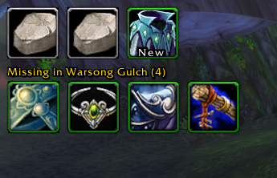

# ASDrops

An **Azeroth Survivors** addon that shows an icon bar of the loot you receive during the current run, plus a row of items from the current zone you haven't collected yet.

## Features

- **Loot bar** – every item you receive during the current run appears as an icon (up to 20), with a rarity-coloured border, a stack count and a tooltip showing rarity and item type.
- **New / already collected** – the "New in your collection!" and "already collected" loot messages are picked up and shown on the icon.
- **Boss-kill drops** – boss kills are recorded on the bar. If a boss dropped nothing, a *A Pretty Rock* icon is shown, with the boss name in its tooltip.
- **Missing items row** – below the bar, a "Missing in <zone>" row lists items known to drop in the current zone that you haven't collected yet (up to 30 icons). It is filled from loot you see in loot windows and chat, saved per zone, and can optionally be seeded from `ASDropsZoneData.lua`.
- **Backpack mirror** – the loot bar items are also drawn, visual only, in the display slots of your backpack. Nothing is added to or changed in your real inventory.
- **Movable and resizable** – both rows can be dragged, resized and locked; position and size are saved.

## Screenshots

**Loot bar and missing items row** – two boss kills without drops (*A Pretty Rock*), a new item on the top row, and the uncollected items of Warsong Gulch below.

## Installation

1. Download the latest version from the [Releases](../../releases) page.
2. Copy the `ASDrops` folder into `/AddOns`.
3. Restart the game (or reload the UI) and make sure the addon is enabled.

## Interaction

**Loot bar**

- Drag an icon (or the bar) with the left mouse button to move it.
- Drag the grip in the bottom-right corner to resize the icons.
- Right-click an icon or the grip to lock / unlock moving and resizing.

**Missing items row**

- Drag an icon to move the row, drag the bottom-right grip to resize it.
- Right-click an icon to lock / unlock the row.
- Shift + left-click an icon to mark it as collected.
- Shift + right-click an icon to remove it from the zone's list.

## Known Quirks

- The backpack mirror only appears once the backpack has been opened, as its slots are created then. It uses the backpack's display slots only (`ContainerFrame1`).
- The loot bar holds at most 20 entries and the missing row shows at most 30 icons; further missing items are summarised next to the row.
- Items you didn't see drop (never in a loot window or chat) are not known to the missing row; add them with `/asmissing add`, or through `ASDropsZoneData.lua`.
- Loot detection relies on the loot chat messages, so replacements for the default chat or loot UI may behave differently.

## Commands

| Command | Description |
| --- | --- |
| `/asmissing list` | Prints how many items are known, collected and missing in the current zone, and lists the missing ones. |
| `/asmissing collected <item>` | Marks an item in the current zone as collected (item link, item id or name). |
| `/asmissing missing <item>` | Marks an item in the current zone as missing again. |
| `/asmissing add <item link>` | Adds an item (shift-click its link) to the current zone's list as missing. |
| `/asmissing remove <item>` | Removes an item from the current zone's list. |
| `/asmissing reset` | Clears the current zone's list. |
| `/asmissing lock` / `unlock` | Locks or unlocks moving of the missing row. |
| `/asmissing show` / `hide` | Shows or hides the missing row. |
| `/asdrops debug` | Prints the recorded drops and the bar state to the chat frame. |
| `/asdropsbag debug` | Prints the backpack mirror status (items mirrored, bag slots found, copies shown). |

## Saved Variables

- `ASDropsDB` – loot bar items, position and size (`ASDropReminderDB` is read as a fallback for older saves).
- `ASDropsZoneDB` – the per-zone missing lists and the missing row's settings.

## Releases

Releases are published automatically on GitHub Releases whenever a pull request is merged into `main` (see [`.github/workflows/release.yml`](.github/workflows/release.yml)).

## How it works, quick TLDR

ASDrops listens to the loot chat messages and to the Azeroth Survivors boss-kill banners, and records each drop with its rarity, type and new/collected status on the main bar. The current zone and class are read from Azeroth Survivors; every item seen dropping in a zone is remembered for it, and stays in the missing row until you loot it. The backpack mirror simply draws copies of the bar's icons over the backpack's slots, without touching real inventory.

## AI Usage

ASDrops is created using GitHub Copilot (Claude Sonnet 5.5), since I'm not very knowledgeable in Lua nor the 1.12 WoW API
